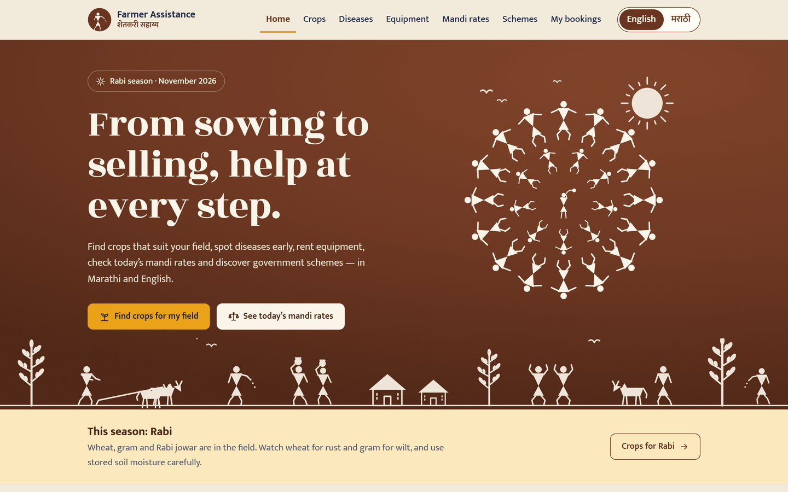
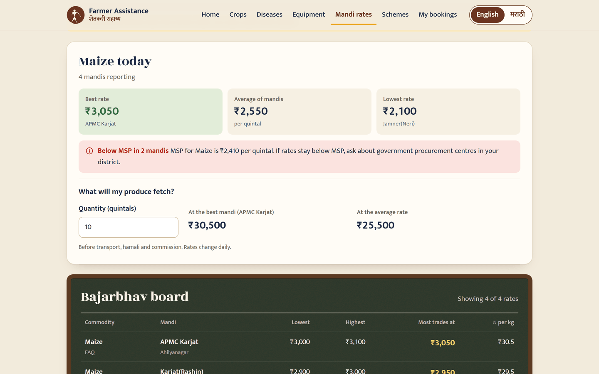
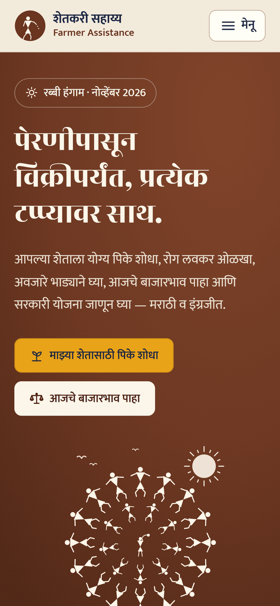

# Farmer Assistance · शेतकरी सहाय्य

A bilingual (English + मराठी) web app that helps Maharashtra farmers at every step **from sowing to selling**:
which crop to grow, how to spot crop diseases, where to rent equipment, what the mandi is paying today,
and which government schemes they can apply for.

**Live site:** https://farmer-assistance-v2.vercel.app · **Docs & slides:** https://farmer-assistance-v2.vercel.app/docs/

| | |
|---|---|
| **Team** | Shravani Rajput (52) · Prachi Sagvekar (54) · Drishti Rathi (53) |
| **Guide** | Dr. Sanjay Shitole |
| **Department** | Information Technology · Semester 3 |
| **College** | UMIT, SNDT |



---

## The five features

| # | Feature | What the farmer gets | Where the data comes from |
|---|---------|----------------------|---------------------------|
| 1 | **Crop Recommendation** · पीक शिफारस | Pick season, soil, water and region → ranked list of suitable crops with sowing time, duration, water needs and MSP | ICAR institutes + Maharashtra agricultural universities (MPKV, PDKV, VNMKV, BSKKV) — 18 crops |
| 2 | **Disease Guide** · रोग मार्गदर्शक | Pick a crop → common diseases with signs, spread conditions, prevention and what to do | ICAR institutes, PDKV Akola, ICAR-CICR, ICAR-DOGR — 20 diseases |
| 3 | **Equipment Rental** · अवजारे भाड्याने | Search equipment, see rates, send a booking request, track it in *My bookings* | Sample listings (clearly labelled) — saved on the phone only |
| 4 | **Agri Market** · बाजारभाव | **Live** APMC mandi rates, best mandi for a crop, below-MSP warning, earnings calculator, official MSP tables | Government of India: AGMARKNET via data.gov.in API; MSP from PIB releases |
| 5 | **Government Schemes** · सरकारी योजना | 6-question eligibility finder, 23 real central + Maharashtra schemes with benefits, documents, steps and official links | Official portals, Government Resolutions, PIB — checked 26 Nov 2026 |

Plus: **full English ↔ Marathi switch** (380+ interface strings + all data), no login, no personal data sent anywhere,
and it **installs as a phone app** (Chrome → *Install app*) that opens full-screen and works offline.

## Quick start

```bash
git clone https://github.com/Shravanirajput/farmer-assistance-system.git
cd farmer-assistance-system
npm install
npm run dev          # opens http://localhost:5173
```

For **live** mandi rates, add a free data.gov.in API key in a file called `.env.local`:

```
DATA_GOV_API_KEY=your-key-here
```

Without a key the site still works and shows the last saved official rates (clearly dated).
Full steps: [docs/SETUP.md](docs/SETUP.md).

## Tech stack

- **React 19 + Vite** — the user interface (a single-page app)
- **Vercel** — hosting for the website and one small serverless function (`/api/mandi`)
- **data.gov.in Open Government Data API** — live mandi prices
- **Plain CSS** with a custom Warli-inspired design, **Mukta** and **Rozha One** fonts (Latin + Devanagari)
- No database, no login — bookings and checklists are stored in the browser (localStorage)

## Documentation

| Document | Read it to… |
|----------|-------------|
| [docs/SETUP.md](docs/SETUP.md) | Run the project on your laptop |
| [docs/DEPLOYMENT.md](docs/DEPLOYMENT.md) | Understand how it is hosted on Vercel and how to deploy changes |
| [docs/FEATURES.md](docs/FEATURES.md) | Understand how each feature works inside |
| [docs/ARCHITECTURE.md](docs/ARCHITECTURE.md) | See the folder structure, data flow and design decisions |
| [docs/DATA-SOURCES.md](docs/DATA-SOURCES.md) | Check where every piece of data comes from |
| [docs/PRESENTATION-GUIDE.md](docs/PRESENTATION-GUIDE.md) | Demo script, who-says-what, and answers to likely viva questions |
| [docs/presentation/](docs/presentation/) | The slide deck — PowerPoint (with speaker notes) and PDF |

| English | मराठी (mobile) |
|---------|----------------|
|  |  |

## Project structure (short)

```
api/            serverless function that fetches live mandi prices (runs on Vercel)
src/pages/      one file per screen (Home, Crop, Disease, Equipment, History, Market, Schemes)
src/components/ shared pieces: header/footer, Warli art, icons, form controls
src/data/       crops, diseases, equipment, MSP, schemes, saved mandi snapshot
src/i18n/       en.js and mr.js — every piece of interface text in both languages
src/utils/      crop scoring, scheme finder, router, bookings, formatting
scripts/        translation checker and mandi snapshot saver
docs/           project documentation
```

## Available commands

| Command | What it does |
|---------|--------------|
| `npm run dev` | Start the development server with live mandi API |
| `npm run build` | Create the production build in `dist/` |
| `npm run preview` | Serve the production build locally |
| `npm run lint` | Check code quality with ESLint |
| `npm run check:i18n` | Verify every English text has a Marathi version |
| `npm run snapshot` | Save today's official mandi rates as the offline fallback |

## Disclaimer

Information on this site is for guidance only. Farmers should confirm crop, disease and scheme decisions
with their local agriculture office, Krishi Sahayak or Krishi Vigyan Kendra. Kisan Call Centre: **1800-180-1551** (free).
