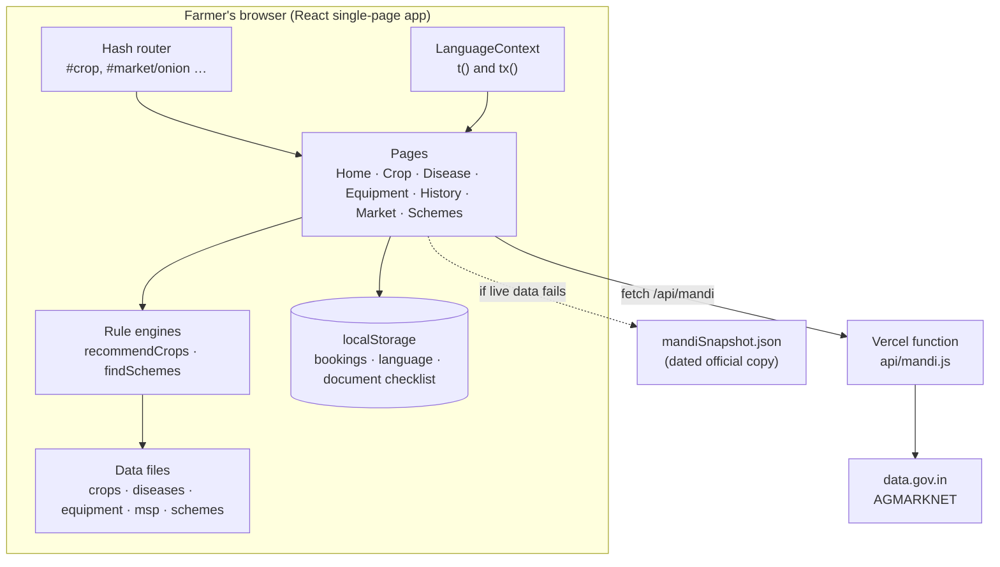

# Architecture

## Big picture



## Why it is built this way

| Decision | Reason |
|----------|--------|
| **React + Vite**, no framework on top | Simple to learn and explain; fast builds; the original project already used it |
| **Hash routing** (`#market`) instead of a router library | Works on any static host without server rules; back button works; ~30 lines of code |
| **Data in JavaScript files**, no database | The data (crops, diseases, schemes, MSP) changes a few times a year and must be reviewed by a person; files are versioned in Git and easy to audit |
| **One serverless function** only for mandi prices | The only live data; keeps the API key secret and allows caching |
| **localStorage** for bookings and checklists | No login needed, works offline, nothing personal leaves the phone |
| **Rule-based logic**, not AI/ML | Every result can be explained to a farmer or examiner |
| **Self-hosted fonts** (Mukta, Rozha One) | Devanagari renders correctly everywhere, no external font requests |
| **Progressive Web App** instead of a separate Android app | One codebase for website and phone app; installs from Chrome, works offline, updates itself without the Play Store |
| **Screens loaded on demand** (`React.lazy`) | Faster first start on slow mobile networks |

## Folder structure

```
farmer-assistance-system/
├── api/
│   ├── mandi.js              # Vercel serverless function: GET /api/mandi
│   └── _lib/mandiCore.js     # fetch + clean + cache logic (shared with local dev)
├── public/
│   ├── favicon.svg           # Warli-style icon
│   ├── manifest.webmanifest  # makes the site installable as an app
│   ├── icons/                # app icons (incl. Android "maskable") and shortcut icons
│   └── screenshots/          # shown in Chrome's install dialog
├── scripts/
│   ├── check-i18n.mjs        # fails if any Marathi translation is missing
│   ├── save-mandi-snapshot.mjs  # saves today's official rates as the offline fallback
│   ├── build-docs.mjs        # turns the Markdown docs into /docs web pages
│   ├── sw-template.js        # the offline service worker (template)
│   └── build-sw.mjs          # writes dist/sw.js with this build's file list and version
├── src/
│   ├── main.jsx              # entry: fonts, styles, LanguageProvider, App
│   ├── App.jsx               # picks the page for the current #route
│   ├── styles.css            # the whole design system (colours, type, layout)
│   ├── components/
│   │   ├── Layout.jsx        # header, navigation, language switch, footer
│   │   ├── PageHeader.jsx    # mud-wall banner on each feature page
│   │   ├── WarliArt.jsx      # hand-coded Warli figures, tarpa circle, frieze
│   │   ├── Icons.jsx         # line icons (24px grid)
│   │   └── Form.jsx          # choice chips, text and select fields
│   ├── pages/                # one file per screen
│   ├── data/                 # crops, diseases, equipment, msp, schemes, commodities, mandiSnapshot.json
│   ├── i18n/                 # en.js, mr.js, languages.js, LanguageContext.jsx
│   └── utils/                # recommendCrops, schemeFinder, router, bookings, format, useMandiData, pwa
├── docs/                     # this documentation (+ images and the slide deck)
├── vite.config.js            # React plugin + serves /api/mandi during npm run dev
├── vercel.json               # function region (Mumbai) and service-worker headers
└── package.json
```

## Key pieces of code to explain in a viva

- **`src/i18n/LanguageContext.jsx`** — React Context holding the chosen language. `t(key)` looks up interface text,
  `tx({en, mr})` picks data text. Saves the choice in localStorage and sets `<html lang>` (helps screen readers and fonts).
- **`src/utils/recommendCrops.js`** — 30 lines: score each crop (season 3, soil 2, water 2, region 1), filter, sort.
- **`src/utils/schemeFinder.js`** — checks each scheme's `rules` against the farmer's answers and explains why it matched.
- **`api/_lib/mandiCore.js`** — builds the data.gov.in URL, pages through results (1000 per request),
  converts `26/11/2026` to `2026-11-26`, trims names, caches for 15 minutes, and returns friendly error codes
  (`missing_key`, `rate_limited`, `timeout`).
- **`src/utils/useMandiData.js`** — React hook: try live → fall back to dated snapshot → else show the setup/error message.
- **`vite.config.js`** — a tiny plugin that mounts the same `api/mandi.js` handler in the dev server,
  so local development behaves exactly like Vercel.
- **`scripts/sw-template.js` + `scripts/build-sw.mjs`** — the offline service worker: saves the app's files on first
  open, serves pages fresh when online and from the saved copy when offline, never caches live prices, and gets a new
  version on every build so installed apps update themselves.
- **`src/utils/pwa.js`** — registers the service worker, keeps Chrome's install prompt for our *Install app* button,
  and tracks online/offline for the offline notice.

## Design system

The look is based on **Warli art**, the traditional painting of the Warli community of Palghar district,
Maharashtra — white figures made of circles, triangles and lines on a mud-brown wall, showing farming,
harvest and the circular *tarpa* dance. All Warli art on the site is drawn in code (`WarliArt.jsx`).

| Token | Colour | Used for |
|-------|--------|----------|
| Mud (geru) | `#6b3420` | Hero, page headers, icons — the Warli wall |
| Rice white | `#fbf5e9` | Warli figures, text on mud |
| Haldi (turmeric) | `#e9a319` | Main buttons, selected state |
| Leaf green | `#2f6b3f` | Good news: best match, best price, helpline |
| Neel (indigo) ink | `#1f2a44` | Body text |
| Kumkum red | `#b42318` | Errors, below-MSP warning |
| Chalkboard green | `#22352b` | The mandi price board |

- **Type:** Rozha One (headlines — high-contrast like Marathi newspaper mastheads), Mukta (all reading text).
- **Accessibility:** 48px+ touch targets, real radio/checkbox inputs under the chips, visible focus rings,
  `aria-live` result regions, reduced-motion support (the tarpa dancers stop spinning), skip link, `lang` attribute.
- **Mobile first:** tables become stacked cards under 720px; the menu collapses under 1060px.
