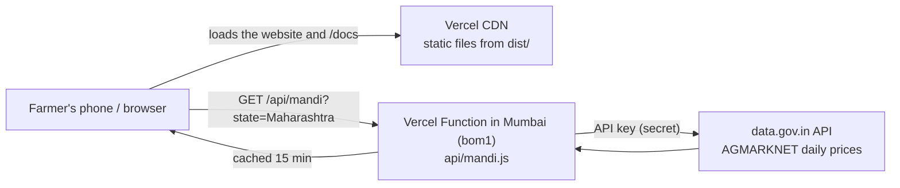

# Deployment — how the site is hosted

Version 2 is hosted on **Vercel** (free "Hobby" plan) as its own project, **`farmer-assistance-v2`**:

| What | Address |
|------|---------|
| The app | https://farmer-assistance-v2.vercel.app |
| Documentation (these pages) | https://farmer-assistance-v2.vercel.app/docs/ |
| Slides (PDF viewer + PowerPoint download) | https://farmer-assistance-v2.vercel.app/docs/presentation.html |

The older version 1 site (`farmer-assistant` project, farmer-assistant-lime.vercel.app) is a separate Vercel project and
was left untouched.

## What Vercel runs



1. **Static website + docs** — `npm run build` does two things:
   - `vite build` turns the React code into plain HTML, CSS and JavaScript in `dist/`;
   - `scripts/build-docs.mjs` turns `README.md` and `docs/*.md` into web pages in `dist/docs/`,
     and copies the screenshots and the slide deck (PDF + PPTX) next to them.

   Vercel serves all of `dist/` from its global CDN (fast, free, HTTPS).
2. **One serverless function** — every file in `api/` becomes a small server endpoint. `api/mandi.js` becomes
   `/api/mandi`. It reads the secret `DATA_GOV_API_KEY`, asks data.gov.in for the day's mandi prices, cleans the data,
   and tells Vercel's CDN to cache the answer for 15 minutes.
3. **Mumbai region** — `vercel.json` sets `"regions": ["bom1"]`. This matters: by default Vercel runs functions in the USA,
   and data.gov.in refuses requests from foreign servers (we saw this happen). Running in Mumbai fixes that and is
   faster for Indian users.

**Why a server function instead of calling data.gov.in from the browser?** So the API key stays secret
(anything in browser code can be read by anyone), and so we can cache and clean the data in one place.

## Deploying a change (how it is set up now)

The project folder is linked to the `farmer-assistance-v2` Vercel project (the link is saved in the `.vercel/` folder,
which is not committed). After making changes:

```powershell
npm run lint
npm run check:i18n
npx vercel deploy --prod
```

The first time on a new laptop, run `npx vercel login` and `npx vercel link --project farmer-assistance-v2` once.
`.vercelignore` makes sure `.env.local` (the API key) and `node_modules` are never uploaded.

### Optional: deploy automatically from GitHub

Run `npx vercel git connect` (or Vercel dashboard → project → Settings → Git) to link the GitHub repository.
After that, every push to `main` deploys automatically and other branches get preview links.

## The API key on Vercel

Vercel dashboard → **farmer-assistance-v2** → **Settings → Environment Variables** → `DATA_GOV_API_KEY` (Production).
After adding or changing it, deploy again (`npx vercel deploy --prod`) — variables only apply to new deployments.

How to get a key: data.gov.in → **Login | Register** (Jan Parichay) → open any dataset's **API** page
(for example the mandi prices API) → **Generate API Key**. Keep it private; **Regenerate** if it ever leaks.

## Checking that the live site works

- Open the site → **Mandi rates**. A green dot and "Live from AGMARKNET" means the key works.
- Open `https://farmer-assistance-v2.vercel.app/api/mandi?state=Maharashtra` — you should see JSON with `records`.
  - `{"error":"missing_key"}` → the environment variable is not set (or you did not redeploy).
  - `{"error":"upstream_error"}` → data.gov.in did not answer; check the region is `bom1` and look at
    `npx vercel logs --deployment farmer-assistance-v2.vercel.app`.
- Open `/docs/` — the documentation and slides should load.

## Before a presentation

1. Run `npm run snapshot` the evening before (needs the key in `.env.local`), then deploy.
   This refreshes `src/data/mandiSnapshot.json` — the dated fallback shown if the internet or data.gov.in fails during the demo.
2. Open every page once on the presentation laptop so fonts and data are cached.
3. Keep the local version ready too: `npm run build` then `npm run preview` works without internet
   (the market page will then show the saved snapshot).

## Cost

Everything used is free: Vercel Hobby plan, the data.gov.in API, and open-source fonts bundled with the site.
The function runs only when someone opens the market page, and CDN caching keeps calls low.

## Rolling back a bad deployment

Vercel dashboard → **farmer-assistance-v2 → Deployments** → pick the last good one → **⋯ → Promote to Production**.
