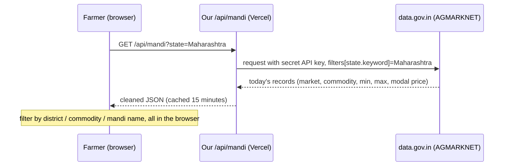

# How each feature works

Every feature follows the same idea: **simple rules + trustworthy data + plain language in two languages.**
Nothing is a black box — every result on screen can be explained by a rule written in this document.

---

## 1. Crop Recommendation · पीक शिफारस

**Farmer's question:** *"What should I grow on my field this season?"*

**Inputs (big tap-able choices):** season (Kharif / Rabi / Summer), soil (black / red / alluvial / laterite —
shown with soil-colour swatches so farmers recognise them), water (low / moderate / high, shown as drops),
and region of Maharashtra (Konkan, Western, North, Marathwada, Vidarbha).

**How it decides — a points system** (`src/utils/recommendCrops.js`):

| Condition | Points |
|-----------|--------|
| Crop grows in the chosen **season** | +3 (**required**) |
| Crop suits the chosen **soil** | +2 |
| Crop suits the **water** available | +2 |
| Crop is common in the farmer's **region** | +1 |

A crop is shown only if the season matches **and** it scores at least 5 of 8 (so season plus soil or water).
7–8 points = "Best match", 5–6 = "Good match". Summer crops have a special rule: they need moderate/high
water even if the same crop is rainfed in Kharif (`seasonWater` in the data).

**Each result card shows:** which conditions matched (✓/✗), when to sow, crop duration, water advice,
this year's **MSP** (linked from the Agri Market data), and buttons to jump to the crop's
**diseases** and **today's mandi rate** — the features are connected.

**Data:** `src/data/crops.js` — 18 Maharashtra crops (soybean, cotton, tur, jowar, gram, wheat, safflower,
rice, nachni, bajra, maize, groundnut, moong, urad, onion, sugarcane, sunflower, watermelon) with sources.

**Why rules and not machine learning?** We have no large, labelled dataset of Maharashtra farm outcomes,
and farmers and examiners can verify a rule. An ML model would be a black box with made-up accuracy.

---

## 2. Disease Guide · रोग मार्गदर्शक

**Farmer's question:** *"What is wrong with my crop, and what should I do?"*

1. Tap a crop (11 crops). 2. See its common diseases as cards (with cause: fungus / virus / bacteria).
3. Open one to see **signs to look for, when it spreads, how to prevent it, what to do**, and the source.

**Deliberate choice:** we never name chemicals or doses. Wrong pesticide advice can harm crops, farmers
and soil, so every page says *confirm with your Krishi Sahayak / KVK before spraying* and gives the
Kisan Call Centre number (1800-180-1551).

**Data:** `src/data/diseases.js` — 20 diseases from ICAR institutes and Maharashtra universities.
Crop Recommendation links directly here (e.g. `#disease/soybean`).

---

## 3. Equipment Rental · अवजारे भाड्याने

**Farmer's question:** *"Where can I rent a tractor or sprayer, and what will it cost?"*

- Search by name or place, filter by type (tractors, tillage, sowing, spraying, harvesting, other).
- Open a listing → **Request booking** → name, mobile, village, start date, days, message.
- **Validation:** name required, Indian mobile number (10 digits starting 6–9), date today or later, 1–30 days.
- The estimated rent updates live (rate × days).
- The request is saved in the browser's **localStorage** and appears in **My bookings**, where it can be cancelled.

**Honesty note shown on screen:** the 12 listings are **sample listings** that demonstrate the flow — the owners
and rates are examples. In a real launch, owners would register their machines or listings would come from
Government **Custom Hiring Centres** (the page points farmers to the Government's FARMS app and taluka office).

**Privacy:** the farmer's details never leave the phone — there is no server or database.

---

## 4. Agri Market · बाजारभाव (new)

**Farmer's question:** *"What price will I get today, and which mandi pays best?"*

### Live mandi rates

- **Source:** "Current Daily Price of Various Commodities from Various Markets (Mandi)", Ministry of Agriculture
  & Farmers Welfare, published on data.gov.in from AGMARKNET (resource `9ef84268-d588-465a-a308-a864a43d0070`).
- Prices are **₹ per quintal**: lowest, highest and **modal** (the price at which most produce sold that day).
  We also show ≈ ₹ per kg (modal ÷ 100) because farmers often think per kg.
- **Bajarbhav board:** styled like the chalk price boards at APMC mandis. Field crops are listed first.
- **Crop insight** (when a commodity is chosen): best mandi, average and lowest rate, and a **below-MSP warning**
  if any mandi is paying less than the Government's MSP — with advice to ask about procurement centres.
- **"What will my produce fetch?" calculator:** quantity (quintals) × best modal price, and × average price.
  It reminds farmers that transport, hamali and commission are not included.

### If the live data cannot load

We **never show made-up prices**. In order:
1. Live data from data.gov.in (green dot, "Live from AGMARKNET").
2. If the key is missing or the API fails: the **last saved official snapshot** (`src/data/mandiSnapshot.json`,
   created by `npm run snapshot`) with a yellow banner saying the exact date it was saved.
3. If there is no snapshot: a clear message and a button to open the official AGMARKNET portal.

### MSP tab

Official **Minimum Support Prices** for 14 Kharif crops in 17 price rows, since paddy, jowar and cotton each have two grades (marketing season 2026-27, PIB release 13 May 2026),
and 6 Rabi crops (marketing season 2027-28, PIB release 30 Sep 2026), with last year's price and the increase.
Notes explain that sugarcane has FRP instead of MSP and how to sell at MSP through procurement agencies.

Also: a pointer to **e-NAM** for selling online.

---

## 5. Government Schemes · सरकारी योजना (new)

**Farmer's question:** *"Which government schemes can I get, and how do I apply?"*

### "Find schemes for me" — 6 questions

1. Where is your farm? (Maharashtra / another state)
2. Is farmland recorded in your name? (yes / no — tenant or labourer)
3. How much land? (up to 1 ha / 1–2 ha / more than 2 ha — acres shown too)
4. Age
5. Social category (General / OBC / SC / ST)
6. What help do you need? (income support, insurance, loan, irrigation, solar pump, machinery, pension…)

**Rules** (`src/utils/schemeFinder.js`) — a scheme is shown only if it passes every rule written in its data:
state, land ownership, age range, land limit, and social category. Schemes that match a chosen **need** are listed
first, and schemes made for the farmer's own group (e.g. SC/ST) rank above general ones. Each card says **why**
it may suit the farmer. Final eligibility is always decided by the department — the page says so.

### 23 real schemes

- **Central (13):** PM-KISAN, PM Fasal Bima Yojana, Kisan Credit Card, PM Kisan Maandhan (pension),
  Soil Health Card, Per Drop More Crop, PM-KUSUM, Farm Mechanisation (SMAM), Paramparagat Krishi Vikas Yojana,
  National Mission on Natural Farming, e-NAM, Pulses Mission, Agriculture Infrastructure Fund.
- **Maharashtra (10):** Namo Shetkari Mahasanman Nidhi, Magel Tyala Saur Krushi Pump, Baliraja free electricity,
  Gopinath Munde accident grant, Bhausaheb Fundkar orchard scheme, Magel Tyala Shettale (farm pond),
  Dr. Babasaheb Ambedkar Krishi Swavalamban (SC), Birsa Munda Krishi Kranti (ST), PoCRA 2.0,
  Ahilyadevi Holkar Karjmukti 2026 (loan waiver).

Each scheme page shows: headline benefit, what you get, who can / cannot apply, **document checklist**
(tick what you have — saved on the phone), numbered steps to apply, official website, helpline, current status,
official sources and the date checked. A "Before you apply" panel explains **Farmer ID (Agristack)** and
**MahaDBT** (now first-come-first-served).

**Accuracy rules we followed:** only official sources (.gov.in, Government Resolutions, PIB, DGIPR);
no instalment dates (they change often); where something was announced but no order was found, the status
says so (e.g. Namo Shetkari ₹9,000 announcement, Gopinath Munde 2026 expansion, KCC ₹5 lakh).

---

## 6. English ↔ Marathi · इंग्रजी ↔ मराठी

- Language switch in the header; the choice is remembered on the phone.
- **Interface text:** `src/i18n/en.js` and `src/i18n/mr.js` hold the same keys. Components call
  `t('crop.submit')` and get "Show suitable crops" or "योग्य पिके दाखवा".
- **Data text:** every crop, disease, equipment, MSP row and scheme stores `{ en: '…', mr: '…' }`; components call
  `tx(value)` to pick the right one.
- **Mandi data** arrives in English from the Government API, so common commodity and district names are
  translated with a lookup table (`src/data/commodities.js`). Market (APMC) names stay as published.
- `npm run check:i18n` fails if any English key or data field is missing its Marathi version — currently
  380+ interface keys + all data pass.
- Fonts **Mukta** and **Rozha One** support both scripts, so English and Marathi look consistent.
- **Adding Hindi later:** copy `mr.js` to `hi.js`, translate, add `hi` to `src/i18n/languages.js` and to the
  dictionary list in `LanguageContext.jsx`, and add `hi` values to the data files.

Marathi was written in plain, everyday farming language (बाजारभाव, हमीभाव, खरीप/रब्बी, कृषी सहाय्यक).
**Please have a native Marathi speaker in the team proofread it before the final submission.**
